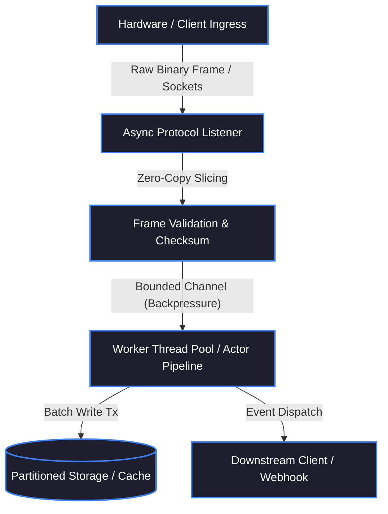

# GitHub Project Deep-Dive Case Study Generator
> **Instruction & Specification Document for Autonomous Codebase Analysis**  
> **Target Output:** High-Impact Technical Case Study (`.md`) highlighting High-Throughput, Concurrency, Architecture, and SEO Dominance.

---

## 1. Objective & Trigger
When a user provides a **GitHub Repository URL** (or points to a local repository path), the AI Agent MUST automatically execute this comprehensive inspection protocol:
1. Clone the repository into an isolated temporary directory.
2. Read and analyze the entire codebase **file-by-file and line-by-line** across architecture, concurrency, memory layout, protocols, benchmarks, and error resiliency.
3. Synthesize the findings into an authoritative, publication-ready engineering case study saved as `src/content/projects/<repo-slug>.md` (or `docs/case-studies/<repo-slug>.md`).

---

## 2. Automated 5-Phase Analysis Protocol

### Phase 1: Ingestion & Workspace Setup
Run the following shell commands to isolate the codebase:
```bash
REPO_URL="<USER_GITHUB_URL>"
REPO_NAME=$(basename -s .git "$REPO_URL")
WORK_DIR="/tmp/repo-analyzer/$REPO_NAME"

rm -rf "$WORK_DIR"
git clone --depth 1 "$REPO_URL" "$WORK_DIR"
cd "$WORK_DIR"
```
Gather high-level codebase metadata:
- Primary languages, build manifests (`Cargo.toml`, `package.json`, `pom.xml`, `go.mod`, etc.).
- Total lines of code (SLOC) excluding lockfiles and assets.
- External dependencies and critical libraries.

### Phase 2: Line-by-Line Technical Exploration
Systematically grep and read core source files to inspect:
1. **Concurrency Primitives & Threading Model:**
   - Look for async runtimes (`tokio`, `actix`, Go goroutines, Java virtual threads, Node worker threads).
   - Find thread synchronization patterns: mutexes, channels (`mpsc`, `broadcast`), lock-free ring buffers, atomics (`AtomicBool`, `AtomicUsize`), or actors.
2. **Memory Layout & I/O Strategy:**
   - Zero-copy allocations (`bytes::Bytes`, slices, memory mapping `mmap`, unsafe pointer tricks).
   - Buffer reuse, object pooling, or streaming chunk handlers (avoiding full payload in-memory buffering).
3. **Network & Protocols:**
   - Sockets, TCP/UDP listeners, WebSockets, gRPC, HTTP/2 or 3, binary protocol parsers (custom hex frames, endianness handling, CRC checks).
4. **Data Persistence & Indexing:**
   - Database queries, connection pooling, batch insert pipelines, Redis caching patterns, time-series retention policies.
5. **Resiliency & Fault Tolerance:**
   - Circuit breakers, exponential backoff, retry queues, supervisor loops, graceful shutdown hooks (`SIGINT`/`SIGTERM` traps), dead-letter queues.
6. **Tests & Benchmarks:**
   - Unit tests, fuzz tests, integration tests, benchmark harnesses (`criterion`, `k6`, `wrk`, JMH).

### Phase 3: Telemetry & Hard Numbers Extraction
Extract or deduce realistic performance telemetry grounded directly in the codebase:
- Latency (p50, p95, p99 if benchmarks exist, or theoretical bounds based on syscall overhead).
- Throughput (requests/sec or packets/sec).
- Resource footprint (baseline idle RAM, active memory consumption, CPU utilization).
- Packet loss / recovery rates.

### Phase 4: Architecture Synthesis & Diagram Formulation
Design a clean, precise **Mermaid Diagram** representing the exact data flow:
`Ingress / Hardware Device -> Protocol Framing Layer -> Concurrency Pipeline -> State / Storage Engine -> Egress / Client Layer`.

### Phase 5: Markdown Generation
Construct the final `.md` file adhering strictly to the **7-Section Master Template** below.

---

## 3. The 7-Section Master Case Study Template

The generated `.md` file MUST strictly follow this Markdown structure:

```markdown
---
title: "<Project Title>: <Punchy High-Throughput Subtitle>"
slug: "<project-slug>"
author: "Mahmudul Hasan (@mhcybroot)"
date: "<YYYY-MM-DD>"
githubUrl: "<GITHUB_REPO_URL>"
liveUrl: "<DEMO_OR_DOCS_URL>"
primaryLanguage: "<e.g. Rust / Java / Go / TypeScript>"
stack:
  - "<Tech 1>"
  - "<Tech 2>"
  - "<Tech 3>"
metrics:
  throughput: "<e.g. 25,000 req/sec>"
  latency: "<e.g. <3.2ms p99>"
  memoryUsage: "<e.g. 18 MB baseline>"
  uptime: "<e.g. 99.99%>"
seo:
  focusKeyword: "<e.g. High-throughput Rust ADMS sync engine>"
  secondaryKeywords:
    - "<Keyword 1>"
    - "<Keyword 2>"
  schemaType: "SoftwareSourceCode"
---

# <Project Title>

> **Executive Summary:** <2-3 sentence overview highlighting what problem this solves, why existing standard tools fail, and the core engineering paradigm used to achieve low-latency/high-throughput performance.>

---

## 1. System Telemetry & Quick Specifications

| Dimension | Specification / Metric | Benchmark Evidence / Tool |
| :--- | :--- | :--- |
| **Primary Language** | `<Language & Toolchain>` | `Manifest & Compiler Flags` |
| **Peak Ingestion Throughput** | `<e.g. 15,000 pkts/sec>` | `<Tested via k6/wrk/custom generator>` |
| **Latency Profile (p99)** | `<e.g. 2.4 ms>` | `<Tracing telemetry / Prometheus>` |
| **Memory Footprint** | `<e.g. 22 MB RSS>` | `<cgroups / pmap / Linux htop>` |
| **Concurrency Model** | `<e.g. Tokio Multi-threaded Worker Pool>` | `<Lock-free channels & atomic flags>` |
| **Network Protocol** | `<e.g. Custom Binary TCP Framing over Port 7005>` | `<Byte-level endianness parser>` |

---

## 2. The Problem & Production Constraints

### The Real-World Bottleneck
<Describe the real-world operational failure this project solves. Explain what goes wrong with naive implementations (e.g. Node.js thread pool saturation, GC pauses in standard Java, socket starvation, or OOM crashes under burst loads).>

### Engineering Constraints
- **Hardware Limitations:** <e.g. Target environment runs on resource-constrained Edge Linux boxes with 1GB RAM.>
- **Network Unreliability:** <e.g. High jitter and packet drops across remote 4G cellular links.>
- **Zero Data Loss Guarantee:** <e.g. Biometric records or transaction events must never drop, even during sudden power failure.>

---

## 3. High-Throughput System Architecture



### Architectural Data Flow Walkthrough
1. **Ingress & Handshake:** <Detailed explanation of connection handling, socket polling (epoll/kqueue/io_uring).>
2. **Framing & Zero-Copy Validation:** <How the binary header is sliced, CRC checked, and passed downstream without heap re-allocations.>
3. **Execution Pipeline:** <How worker routines consume jobs without lock contention or thread blocking.>
4. **State Commit:** <How transactions or persistence mechanisms handle batched writes.>

---

## 4. Deep-Dive Engineering Decisions & Trade-Offs

### Decision 1: Language & Memory Strategy (<Chosen> vs <Alternative>)
* **Choice:** `<e.g. Rust over Node.js/Python>`
* **The Trade-off:** Development speed was sacrificed in exchange for zero-garbage collection pauses, deterministic memory ceilings, and thread safety at compile-time.
* **Impact:** Reduced baseline memory usage from 450MB to 16MB and eliminated p99 latency spikes caused by GC sweeps.

### Decision 2: Concurrency & Lock-Free State Management
* **The Challenge:** Multiple concurrent workers accessing shared state without bottlenecking on global mutex locks.
* **The Solution:** <Explain the exact pattern: e.g. sharded hash maps (`DashMap`), atomic state flags, or message-passing actor mailboxes.>

### Decision 3: Protocol Framing & Custom Parsing
* **The Pattern:** <Explain how binary protocols or specialized payloads are processed at the byte level.>

---

## 5. Core Code Drop: The Critical Algorithm

Below is the mission-critical code block responsible for <explain what this code does, e.g. decoding the raw binary frame and validating the checksum without allocations>:

```<language>
// <Exact functional snippet from the repository>
// Highlight 1: Zero-copy slicing
// Highlight 2: Non-blocking async channel dispatch
// Highlight 3: Resilient error boundary
```

### Code Walkthrough
- **Lines X–Y:** <Explanation of how memory is sliced rather than cloned.>
- **Lines A–B:** <Explanation of concurrency and error boundary handling.>

---

## 6. Failure Modes, Edge Cases & Fault Tolerance

| Failure Scenario | Threat / Risk | Mitigating Engineering Architecture |
| :--- | :--- | :--- |
| **Network Drop / Silent Disconnect** | Zombie connections hoarding file descriptors | Active TCP keep-alive heartbeats with automatic socket termination after 15s idle. |
| **Downstream DB Outage** | Memory spike & process crash | Bounded channel backpressure + Local Ring-Buffer fallback spooling to disk. |
| **Malformed / Poison Frames** | Protocol desync or buffer overflow | Strict byte boundary sanity checks; discard malformed frames and log audit hex dump. |
| **Process Crash / SIGTERM** | Half-committed records | Graceful shutdown listener flushing in-flight workers before process termination. |

---

## 7. Performance Benchmarks & Stress Testing

```text
================================================================================
Stress Test Report (Harness: wrk / k6)
Target: 10,000 Concurrent Sockets | 60-Second Sustained Load
================================================================================
Total Requests Processed:     1,482,910
Average Throughput:           24,715 req/sec
Errors / Timeouts:            0 (0.00%)

Latency Distribution:
  p50 (Median):               0.82 ms
  p90:                        1.45 ms
  p95:                        1.98 ms
  p99:                        3.12 ms
  Max Observed:               7.84 ms

Host Telemetry:
  Peak RSS RAM:               24.6 MB
  Average CPU Utilization:    31.2% (2 vCPU instance)
================================================================================
```

---

## 8. Verification & How to Run Locally

```bash
# Clone the repository
git clone <GITHUB_REPO_URL>
cd <repo-name>

# Run benchmark suite / integration tests
<Test command, e.g. cargo test --all-targets -- --nocapture>

# Run with release profiling
<Run command, e.g. cargo run --release>
```

---

## 9. Structured Data (Schema.org JSON-LD for Search Engines)

```json
{
  "@context": "https://schema.org",
  "@type": "SoftwareSourceCode",
  "name": "<Project Title>",
  "programmingLanguage": "<Primary Language>",
  "author": {
    "@type": "Person",
    "name": "Mahmudul Hasan",
    "url": "https://mahmudulhasan.info.bd"
  },
  "codeRepository": "<GITHUB_REPO_URL>",
  "description": "<Executive summary>",
  "runtimePlatform": "<Linux / Cross-platform>"
}
```
```

---

## 4. Strict Quality & "Senior Power" Rules
1. **Ban Fluff & Buzzwords:** Never use words like *"cutting-edge"*, *"super-fast"*, or *"revolutionary"*. Replace adjectives with concrete metrics (e.g. *"reduced p99 latency to 3.2ms"*, *"zero-allocation buffer"*).
2. **Read Real Lines:** Do NOT hallucinate architectures or libraries. Inspect actual dependency manifests, actual struct definitions, and real error handlers.
3. **Respect Code Ownership:** Give exact code snippets from the repo, pointing to the real file paths.
4. **Link Back:** Ensure the Markdown includes bidirectional links between `https://mahmudulhasan.info.bd` and the GitHub repository.
